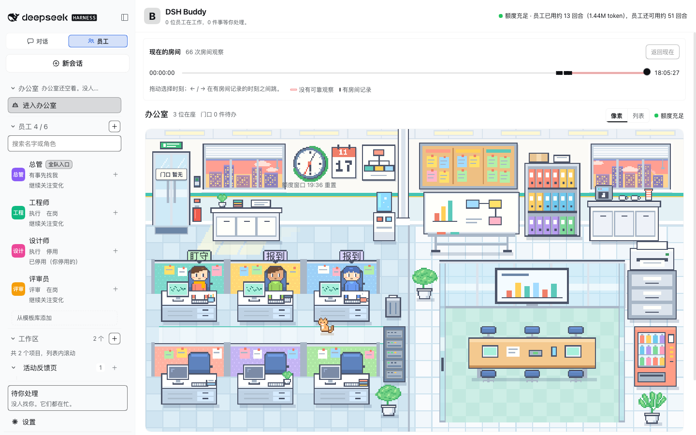
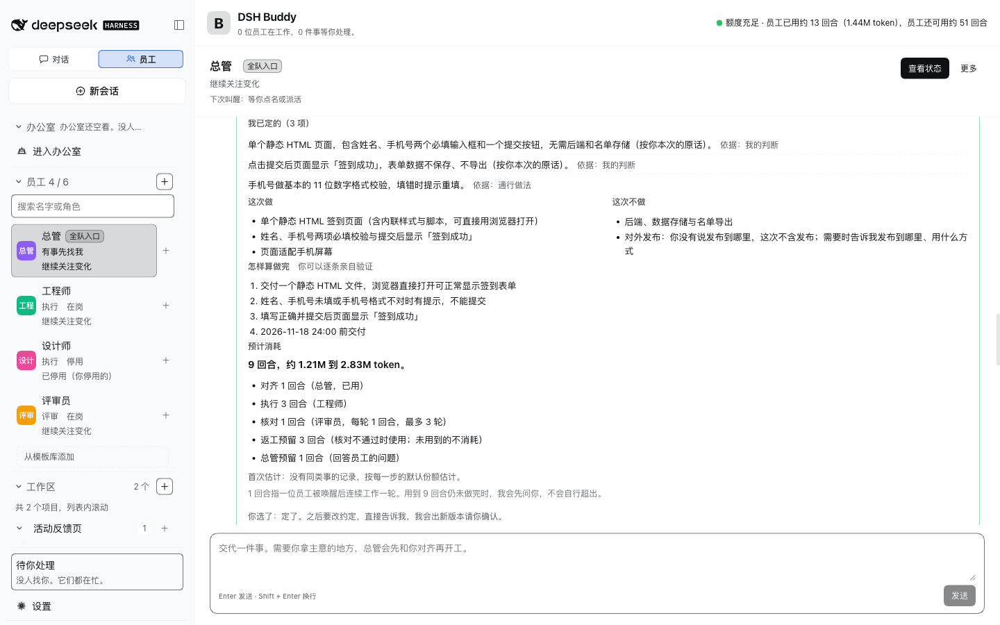
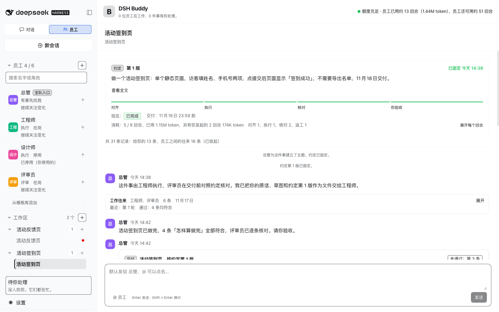
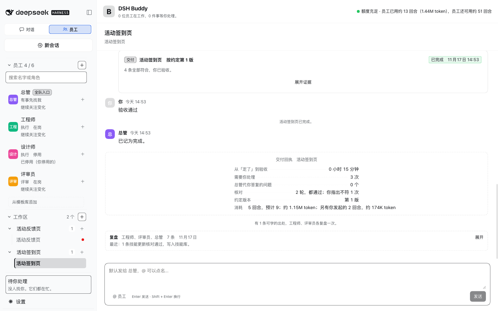
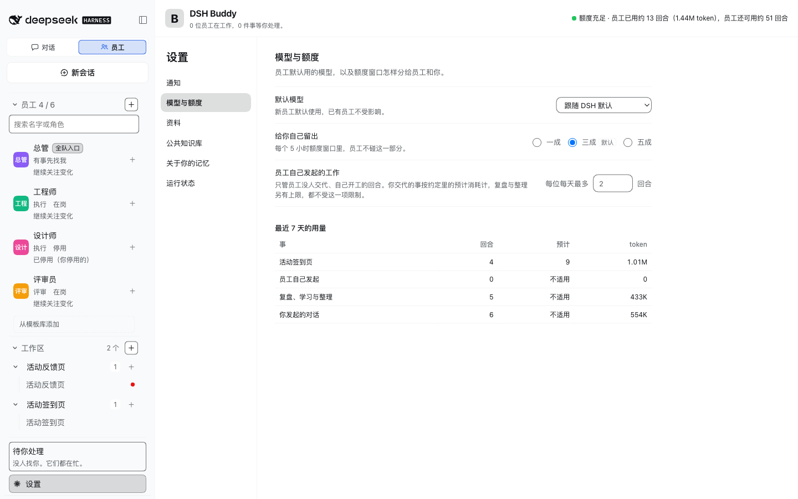
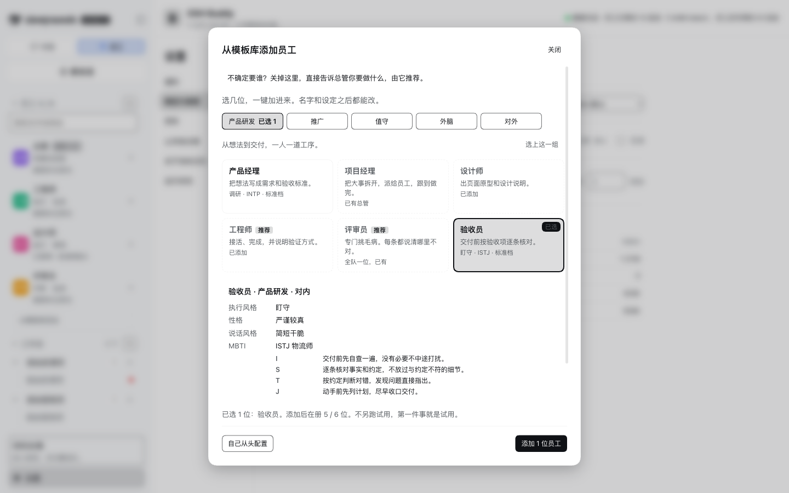

# DSH Buddy

   

**你的 OPC 专业团队。**

一支看得见、管得住的 AI 团队，给一个人的公司（OPC）用。DSH Buddy 是 DeepSeek Harness 桌面版的插件：你对总管说一件事，总管先和你对齐「约定」，写明怎样算做完和预计消耗；你点「定了」才开工。员工执行，交回的结果逐条核对之后，再交给你验收。谁在忙，像素办公室里看得到；花了多少，每件事都有记录。



产品介绍页：https://tyr1105.github.io/dsh-buddy-landing/

## 安装

需要 macOS 上的 DeepSeek Harness 桌面版 0.2.x（0.2.1 起）。插件免费，使用你 DSH 里现有的模型和额度。

1. 打开 DSH 的插件页，点「添加插件」，填包名 `@tyr1105/dsh-buddy`。
2. 完全退出 DSH，再重新打开。
3. 在左栏顶部的「对话 / 员工」切换里点「员工」。

也可以用命令行安装。先完全退出 DSH，再运行：

```bash
"/Applications/DeepSeek Harness.app/Contents/Resources/runtime/cli/bin/dsh" plugin --profile desktop add @tyr1105/dsh-buddy
```

卸载时把 `add` 换成 `remove`。员工的数据保存在 `~/AgentHub`，卸载不会删除。

从 0.2.0 升级：更新插件后完全退出并重新打开 DSH，新版本才会生效。数据仍在 `~/AgentHub`，升级时自动迁移，不会丢失。详见 [0.3.0 发版说明](https://github.com/tyr1105/dsh-buddy/releases)。

## 上手

1. **回答总管的三个问题。** 第一次打开，团队里只有总管（全队的入口）。它依次问：主要想让团队做哪类事、手上有没有已经在做的项目、希望多久被打扰一次。每问都可以点选，也可以直接写。
2. **确认组队卡。** 总管推荐不超过 3 位员工，每位写明模板、适合做什么、性格对应的四句行为说明、模型档位和预计消耗。你可以改名、换一位、不要某一位，也可以就地改性格和模型。确认后员工直接在岗，不另外试跑。
3. **对总管说第一件事。** 在总管的对话里写下要做的事。一步能答或需求明确的小事，总管直接安排；有需要你拿主意的地方，总管先给出一张约定卡。
4. **点「定了」。** 约定卡写明：一句话复述、草图、待你定的事项（每项附建议）、总管已定的事项、这次做与不做、怎样算做完、预计消耗。要改哪里，直接在输入框里写，总管出新的一版。点「定了」之前不会开工。
5. **验收。** 做完之后，总管把结论和每一条「怎样算做完」的证据交给你。没有问题就点「验收通过」；哪条不符，写明第几条、什么问题，只返工这一条。验收之后，这件事的主题里出现交付回执，写明实际用了多少回合和 token。

需要你确认、验收或批准的事，都集中在「待你处理」，也可以在那里直接写一句要修改的地方。

## 它帮你做什么

| 你想要 | DSH Buddy 怎么做 |
| --- | --- |
| **只对一个人交代** | 总管是全队唯一的入口。一件事交给一位员工执行，核对由评审员负责，改动小的事由总管自己核对。执行中，约定能回答的问题由总管直接答复，不打扰你。 |
| **开工前先说清楚** | 约定卡把范围、待你定的事项和「怎样算做完」写在一起。你点「定了」后约定固定；之后要改，总管出新的一版请你确认，并写明哪些照常在做、哪些暂停。 |
| **交回来的东西能核对** | 员工交回时，每一条「怎样算做完」都附证据；评审员逐条核对，不符的写明改到什么程度算过，最多三轮。三轮仍不过时停下，告诉你卡在哪、试过什么，并给出几个办法和建议。 |
| **知道每件事花了多少** | 约定里有预计消耗：总回合数、按步骤拆分、token 区间，返工预留算在内。主题页的进度行显示已用和预计；将要超出预计时先问你一次（追加回合、缩小范围或暂停），你没有决定时不会自行超出。 |
| **给自己留出额度** | 顶栏写出本额度窗口里员工已用的回合和 token。每个 5 小时的额度窗口，默认给你自己留出三成，员工不使用这一部分。员工没人交代、自己开工的工作，每位每天默认最多 2 回合。设置页列出最近 7 天按事统计的用量。 |
| **一眼知道谁在忙** | 像素办公室里，员工在做什么，小人就显示什么：工作、排队、盯守、待确认、受阻、休息。点一位员工，右侧列出他今天每段时间在做什么；整间办公室可以倒回到今天的任意时刻。总管右侧栏的「在办的事」列出每件事的状态、在等谁、交付时间和已用回合。 |
| **离开一段时间再回来** | 离开 8 小时以上再打开时，总管的对话里有一段离开期间的摘要：每件事的变化、共用了多少回合和 token、通知过你几次。 |
| **说过的话不用说第二遍** | 你说一句以后都适用的要求，总管当场回一句「已记住」，写明内容和适用范围，可以撤销。之后对齐时，约定里「我已定的」会引用这条规矩并写明出处。设置页的「关于你的记忆」列出系统记住的全部内容，可以更正或删除。 |
| **员工越做越熟** | 一件事核对退回过、或你指出过不符时，验收之后相关员工各复盘一次，把经过核对的经验写进自己的技能库。技能库每一句都注明出处，保留历史版本，可以回退。 |
| **成果放到指定位置** | 约定里可以写明发布到你电脑上的一个文件夹（第一级限于桌面、文稿、下载等几个文件夹）。发布前单独请你批准。 |
| **不想从零配** | 模板库里有 15 个现成角色，分产品研发、推广、值守、外脑、对外五组。名字、性格、说话风格、模型和技能，加进来之后都能改。 |

## 截图

下面几张图的数据来自 2026-11-17 的一次真实试用：三位员工做一个活动签到页。

办公室里能看到每位员工是否在岗、额度窗口和门口的待办。


约定卡写明已定的事、怎样算做完和预计消耗，你点「定了」之后才开工。



每件事有自己的主题页，写明进度、已用回合和 token。



事情做完后，回执列出耗时、需要你处理的次数、核对结果和消耗。



设置里可以调整给自己留出的额度，并按事查看最近 7 天的用量。



模板库按场景分组，选好后一次添加，名字和设定之后都能改。



## 15 个现成角色

| 分组 | 角色 | 能替你做什么 |
| --- | --- | --- |
| 产品研发 | 产品经理 | 把想法写成需求和验收标准。 |
| | 项目经理 | 把大事拆开，派给员工，跟到做完。总管就是用这个模板建的；团队里已有总管时不能再添加。 |
| | 设计师 | 出页面原型和设计说明。 |
| | 工程师（推荐） | 接活、完成，并说明验证方式。 |
| | 评审员（推荐） | 专门挑毛病，每条都说清哪里不对。全队只能有一位。 |
| | 验收员 | 交付前按验收项逐条核对。 |
| 推广 | SEO 专员 | 查关键词，改标题和页面内容。 |
| | 视频策划 | 写推广视频的脚本和分镜。 |
| 值守 | 研究员 | 代查资料、盯守网页，结论附出处。 |
| | 巡检员 | 盯守日志与定时任务，异常时通知。 |
| 外脑 | 追问者 | 连续追问，把含糊的地方问清楚。 |
| | 鬼点子很多 | 专出不按常理的点子。 |
| | 员工教练 | 看员工做得怎么样，给改进建议。 |
| 对外 | 发言人 | 写公告、发版说明和对用户的回复。 |
| | 市场专员 | 看竞品和用户，定卖点和推广计划。 |

办公室一共六个工位，在册最多 6 位（含总管）。也可以从头配一位自己的员工：名字、执行风格、性格、说话风格、性格（MBTI）、模型、岗位技能、员工说明，一页填完；总管和盯守类员工另有自主节奏可选，其余员工只在总管安排或你点名时工作。岗位技能可以选员工自带的，也可以选你 DSH 里已有的技能。

## 和同类有什么不同

DSH Buddy 的重心是「一件事从交代到验收」这条路径可见、可控：

- 开工之前有约定：范围、怎样算做完和预计消耗写明，你确认后才开工。
- 交付之前有核对：每条验收项附证据，经过核对才交给你；你指出不符时只返工那一条。
- 花费有预计、有回执：进度行和交付回执写明回合与 token，将超出预计时先问你。
- 状态看得见：像素办公室和「在办的事」显示谁在做什么、在等谁。

DSH Buddy 现在不接聊天软件，不操作浏览器，没有手机端，也没有由你设定的定时任务。需要这些功能时，可以选用 DSH 生态里提供它们的其他插件。

## 安全边界

- 员工能直接写入的位置：他自己的文件夹 `~/AgentHub/bots/<编号>/`、团队共享文件夹 `~/AgentHub/shared/`，以及他所在项目的项目文件夹（通过专用的工具放入）。
- 员工在这些位置里运行命令、写文件、自测，不再逐条请你批准，由 DSH 的沙箱限制写入范围。沙箱不可用时，宿主命令一律不运行。
- 对外和收不回来的动作要你批准：连接远程机器、推送代码、发布上线、操作云端资源、调用其他应用或发消息、修改系统设置、安装软件、向外部网址发送数据，以及发布到本机文件夹。审批卡第一行是一句说明，并写明费用、能否撤回、批准之后会发生什么；原始命令默认收起。
- `~/.dsh`、`~/.ssh`、`.env` 这类凭据路径，读和写都会被拦下。
- 已知缺口：对外动作按程序名识别，改名、起别名或写进脚本里的调用拦不住；命令原文里的凭据路径检查是字符串匹配，拼接或编码的写法拦不住；读网页不经审批，内容有可能被放进网址带出去；员工做出的预览网页在你的浏览器里打开时，页面里的脚本会运行、可以联网。不要让员工读来路不明的网页，也不要把敏感资料放在他们够得着的地方。

## 现在的边界

2026-11-17 的一次真实试用：团队有工程师、设计师、评审员三位员工，用真实模型做一个活动签到页，由工程师执行、评审员核对，中间退回返工一次。

- 到验收为止共 7 个回合、约 132 万 token。交付回执的消耗一行原文：「5 回合，预计 9；约 1.15M token；另有你发起的 2 回合，约 174K token」。
- 验收之后，工程师和评审员各自复盘，另用 5 个回合、约 43 万 token。这部分不计入这件事的回执，计在用量表的「复盘、学习与整理」一行。
- 全程没有出现审批卡。

已知的问题：

- 一件事交付的那一刻，打开着的主题页进度行会少算最后一个回合的 token；重新打开页面后显示正确。
- 总管的回复由模型生成，提到某件事的状态时仍可能与实际不符；以主题页的进度行为准。
- 顶栏和「本窗口额度」里员工已用的回合与 token 是按额度窗口统计的估算，可能与各件事回执的合计不一致。
- 约定卡草图里的圆圈数字由模型标注，可能没有对应到正确的待你定事项。
- DSH 关着或电脑休眠时，团队不工作。
- 只支持 macOS；DSH 版本要 0.2.1 及以上、0.3.0 以下。

## 接下来要做的

- 把「待你处理」送到手机和聊天软件：先评估能否接入现有的插件。
- 修正上面列出的已知问题，包括交付那一刻进度行的刷新。
- 英文说明；办公室一键存成图片。

想法和问题欢迎提到 [Issues](https://github.com/tyr1105/dsh-buddy/issues)。

## 开发

需要 Node 22 和 pnpm 11。

```bash
git clone https://github.com/tyr1105/dsh-buddy.git
cd dsh-buddy
pnpm install
pnpm -r typecheck
pnpm --filter @agent-hub/core test:fast
pnpm --filter @agent-hub/core test:scenarios
pnpm --filter @tyr1105/dsh-buddy test
```

三条测试命令先后运行，不要同时运行：`test:scenarios` 里有一条限时的长场景测试，机器繁忙时会超时。

从源码安装到桌面版：`bash scripts/make-entrypoints.sh`，再运行 `bash ~/.agent-hub/install.sh`。更多脚本见 `scripts/README.md`。

- `packages/core/`：引擎，纯 TypeScript，不依赖 DSH。
- `packages/plugin/`：DSH 插件，包括界面。

## 许可证

MIT
