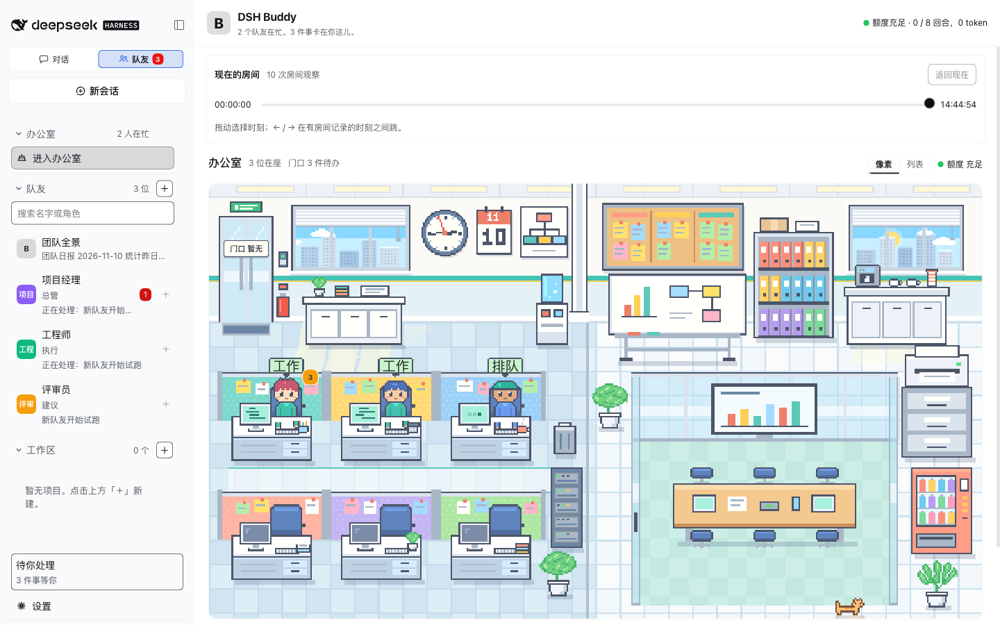
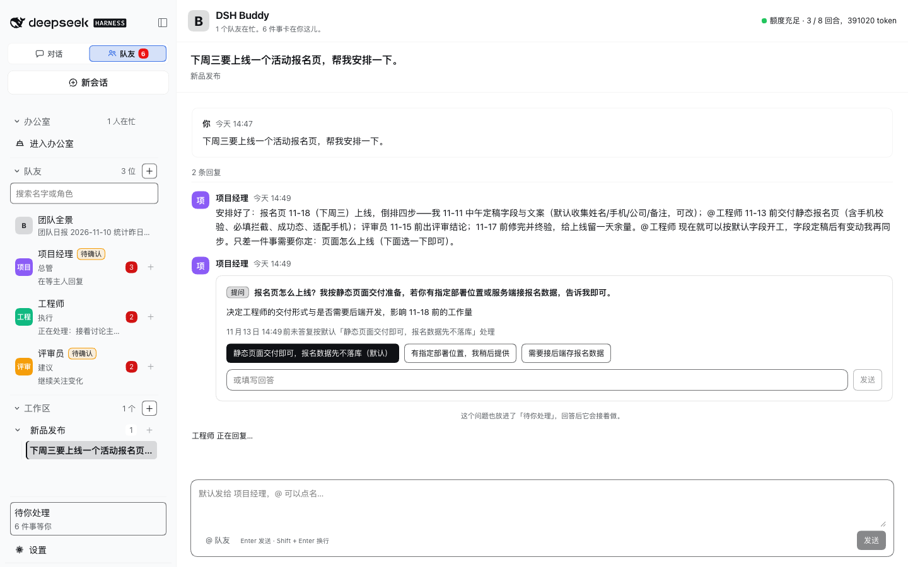
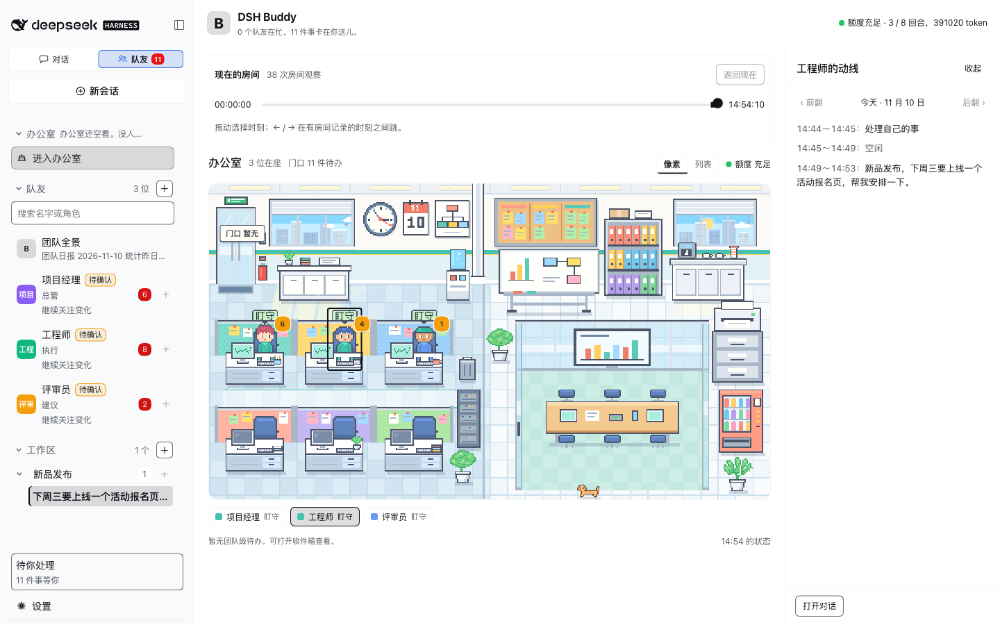
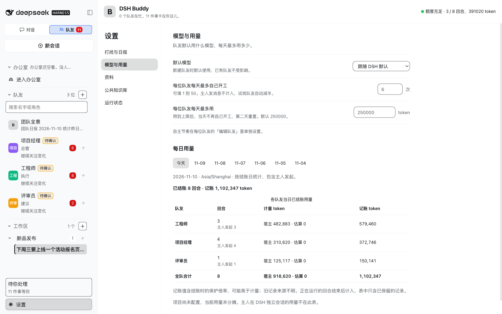

# DSH Buddy

   

**你的 OPC 专业团队。**

DeepSeek Harness 桌面版插件，给一个人的公司（OPC）。一支看得见、管得住的 AI 团队：在 DSH 里招几位 AI 队友，交代一句，负责人安排分工。谁在忙，像素办公室里一眼看到；谁可以自己开工、一天最多自己花多少，都由你定。



产品介绍页：https://tyr1105.github.io/dsh-buddy-landing/

## 安装

需要 macOS 上的 DeepSeek Harness 桌面版 0.2.x（0.2.1 起）。插件免费，用的是你 DSH 里现成的模型和额度。

1. 打开 DSH 的插件页，点「添加插件」，填包名 `@tyr1105/dsh-buddy`。
2. 重新打开 DSH。
3. 在左栏顶部的「对话 / 队友」切换里点「队友」。

也可以用命令行装。先完全退出 DSH，再运行：

```bash
"/Applications/DeepSeek Harness.app/Contents/Resources/runtime/cli/bin/dsh" plugin --profile desktop add @tyr1105/dsh-buddy
```

卸载把 `add` 换成 `remove`。队友的数据留在 `~/AgentHub`，不会被删。

## 上手

1. **挑两位队友。** 点「新建队友」，模板库里有 15 个现成角色。第一次用，选带「推荐」的两位：工程师做事，评审员挑毛病。加进来后各自先试跑一次，会用一点模型额度。
2. **建一个项目。** 起个名字，把两位拉进来，选一位负责人。
3. **说第一句话。** 在项目里点「新开会话」，写下要做的事。不 @ 人，这句话就发给负责人；想点名，就 @ 谁。
4. **等它们来找你。** 需要你回答或批准的事，会出现在「待你处理」。

## 它帮你做什么

| 你想要 | DSH Buddy 怎么做 |
| --- | --- |
| **一眼知道谁在忙** | 像素办公室里，队友在做什么，小人就在做什么：工作、排队、盯守、待确认、受阻、休息。点一位，能看到它今天每段时间做了什么；整间办公室还能倒回今天的任意时刻。 |
| **额度别不知不觉用完** | 每位队友有一档自主节奏：听吩咐、提建议、主动做、全力推进。现成的角色大多默认「听吩咐」，不点名不开工。队友每天自己开工的次数和 token 有上限，设置里能改，用了多少有一张表。 |
| **说一句就开工** | 在项目里新开会话，写下要做的事。负责人接下，点名谁先做、谁来挑毛病；队友在同一条会话里互相 @，你随时能插话。你每说一句，队友最多接着说 8 次，最后一次留给负责人收尾。 |
| **要紧的动作先问我** | 往外发东西、改自己文件夹以外的文件、运行没见过的命令，都要你批准，一次批准只管这一个动作。提问、审批、提议、告警集中放在「待你处理」。 |
| **有人替我盯着** | 值守的队友（研究员、巡检员）盯文件、网页和日志。盯和判断都不调用模型，有变化才开始想。 |
| **不想从零配** | 15 个现成角色，分产品研发、推广、值守、外脑、对外五组。名字、性格、说话风格、模型和技能，加进来之后都能改。 |

## 截图

下面几张都来自 2026-11-10 的一次真实试用：三位队友用真实模型做一个活动报名页。

说了一句，负责人排好了四步、@ 工程师开工，并发来一张提问卡：



在办公室点一位队友，右边列出它今天每段时间在做什么：



设置里的「模型与用量」。这次试用一共 8 个回合，约 92 万 token：



## 15 个现成角色

| 分组 | 角色 | 能替你做什么 |
| --- | --- | --- |
| 产品研发 | 产品经理 | 把想法写成需求和验收标准。 |
| | 项目经理 | 把大事拆开，派给队友，跟到做完。 |
| | 设计师 | 出页面原型和设计说明。 |
| | 工程师（推荐） | 接活、完成，并说明验证方式。 |
| | 评审员（推荐） | 专门挑毛病。每条都说清哪里不对。 |
| | 验收员 | 交付前按验收项逐条核对。 |
| 推广 | SEO 专员 | 查关键词，改标题和页面内容。 |
| | 视频策划 | 写推广视频的脚本和分镜。 |
| 值守 | 研究员 | 代查资料、盯网页。结论附出处。 |
| | 巡检员 | 盯日志和定时任务，异常时通知。 |
| 外脑 | 追问者 | 连续追问，把含糊的地方问穿。 |
| | 鬼点子很多 | 专出不按常理的点子。 |
| | 员工教练 | 看队友做得怎么样，给改进建议。 |
| 对外 | 发言人 | 写公告、发版说明和对用户的回复。 |
| | 市场专员 | 看竞品和用户，定卖点和推广计划。 |

办公室一共六个工位，同时在岗最多 6 位。也可以从头配一位自己的队友：名字、执行风格、性格和说话风格、MBTI、自主节奏、模型、岗位技能、员工说明，一页填完。岗位技能可以选队友自带的，也可以选你 DSH 里已有的技能。

## 和 DS Bot、Tobs 有什么不同

三个都是在 DeepSeek Harness 里组 AI 团队的开源项目，重心不一样。下表按 2026-11-10 各项目自己的说明整理，之后以它们的说明为准。

| | DSH Buddy | DS Bot | Tobs |
| --- | --- | --- | --- |
| 看队友状态 | 像素办公室，带每人当天做了什么和当天回放 | bot 详情页、用量页 | 首页显示用量和活跃情况 |
| 控制花费 | 自主节奏四档；每人每天自己开工有上限；讨论 8 次封顶 | 群聊由管理员统一回复；用量页 | 首页看用量 |
| 聊天软件 | 没有 | 微信、飞书、钉钉等 8 个 | 飞书、微信、Slack 等 5 个 |
| 浏览器和电脑操作 | 没有 | 有 | 有 |
| 定时任务 | 没有固定时间表；值守队友按变化行动 | 有 | 有 |
| 运行平台 | macOS 上的 DSH 桌面版 | DSH 插件，另有 Windows、macOS、Linux 桌面版 | DSH 插件 |

**怎么选：** 想让 AI 进聊天软件、替你操作网页，选 DS Bot 或 Tobs。想要一支小而省、状态一眼看得见的团队，试试 DSH Buddy。

## 安全边界

- 队友能直接改的只有两处：它自己的文件夹 `~/AgentHub/bots/<编号>/` 和团队共享文件夹 `~/AgentHub/shared/`。
- 改别处的文件、往外发东西、运行没见过的命令，都要你批准。一次批准只对这一个动作有效。
- `~/.dsh`、`~/.ssh`、`.env` 这类凭据路径，读和写都会被拦下。
- 需要沙箱的命令，在沙箱不可用时一律不执行。
- 已知缺口：动作检查只看得到工具参数和命令里写明的内容。读网页直接放行，内容有可能被放进网址带出去；脚本内部的读取和联网拦不住。先别让队友读来路不明的网页，也别把敏感资料放在它们够得着的地方。

## 现在的边界

- 队友要运行命令时，审批会比较多：没见过的命令每条都要你批准，卡片上显示的是原始命令。上面那次试用前后 11 分钟，出了 9 张审批卡。
- 队友每干一轮活大约用十几万 token，几个人讨论一件事就是几十万。
- DSH 关着或电脑休眠时，团队不工作；回来后会补看这段时间的变化。
- 没有接聊天软件，不能操作浏览器，没有手机端。
- 只支持 macOS；DSH 版本要 0.2.1 及以上、0.3.0 以下。

## 接下来要做的

- 审批少一点、看得懂：常见的只读命令不再逐条问，卡片改成大白话。
- 在办公室里直接处理待办、暂停队友、看每个人今天花了多少。
- 装好就带一个示例项目，第一次打开就能看到队友讨论。
- 把「待你处理」送到手机上。

想法和问题欢迎提到 [Issues](https://github.com/tyr1105/dsh-buddy/issues)。觉得有用的话，点个 Star，方便更多人找到它。

## 开发

需要 Node 22 和 pnpm 11。

```bash
git clone https://github.com/tyr1105/dsh-buddy.git
cd dsh-buddy
pnpm install
pnpm -r test
pnpm -r typecheck
```

从源码安装到桌面版：`bash scripts/make-entrypoints.sh`，再运行 `bash ~/.agent-hub/install.sh`。更多脚本见 `scripts/README.md`。

- `packages/core/`：引擎，纯 TypeScript，不依赖 DSH。
- `packages/plugin/`：DSH 插件，包括界面。

## 许可证

MIT
